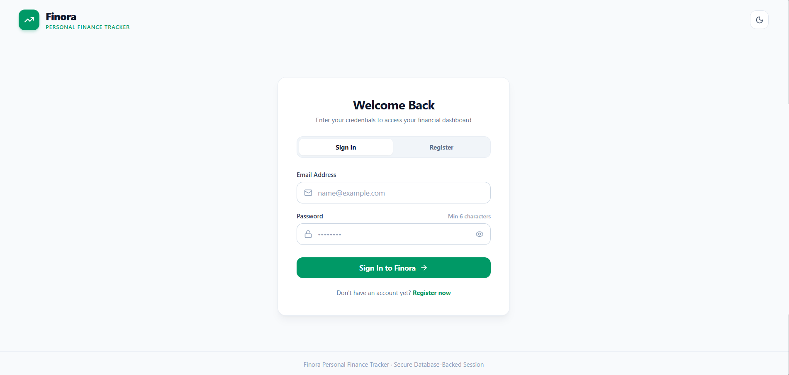
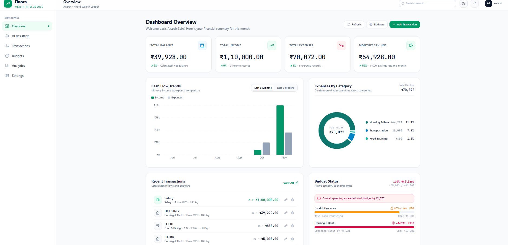
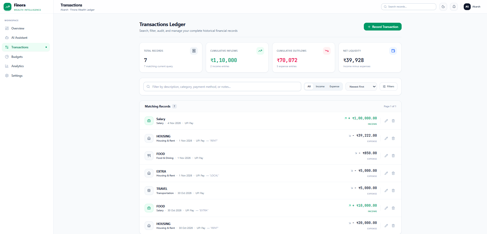
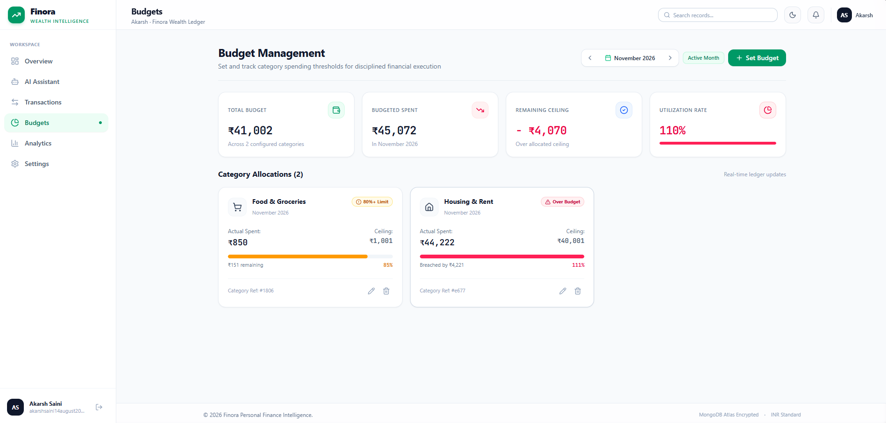
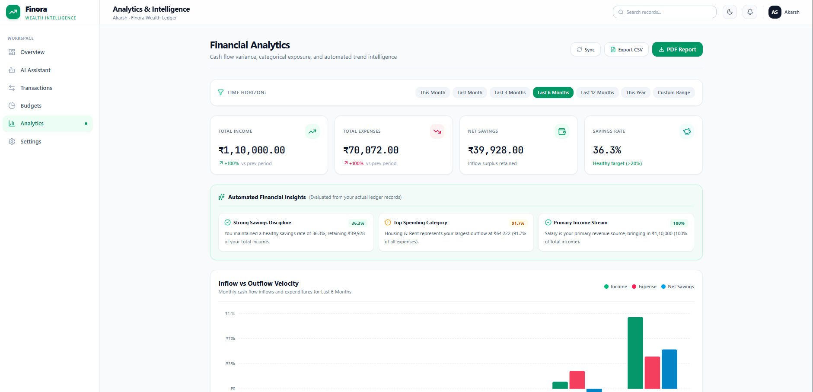
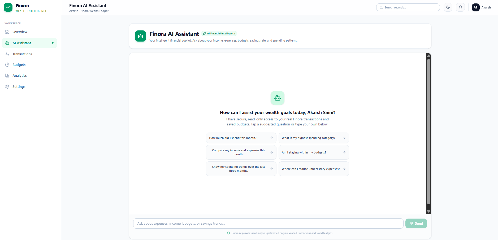
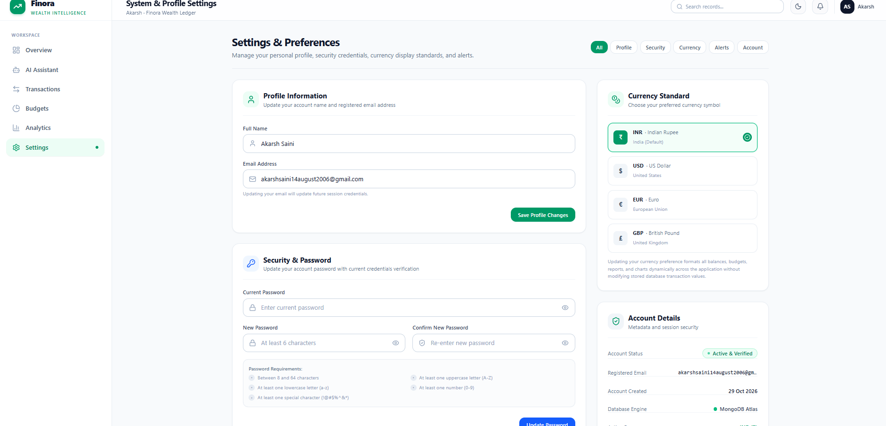
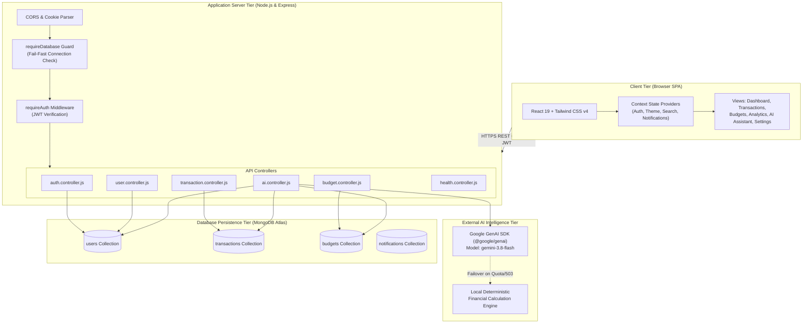

# Finora – Personal Finance Tracker

A modern, full-stack personal wealth management and financial intelligence platform designed to track income, control expenses, enforce budgets, generate exportable analytics, and provide conversational financial insights backed by Google Gemini AI and MongoDB Atlas.

---

### 🚀 Live Demo

[🚀 Live Demo](https://finora-personal-finance-tracker-nqi3.onrender.com)

---

## 📋 Table of Contents

- [1. Project Introduction](#1-project-introduction)
  - [Problem Statement](#problem-statement)
  - [Project Objectives](#project-objectives)
- [2. Technology Stack & Design Decisions](#2-technology-stack--design-decisions)
- [3. Key Features & Practical Use Cases](#3-key-features--practical-use-cases)
- [4. Research & Problem Analysis](#4-research--problem-analysis)
- [5. Application Screenshots & Feature Walkthrough](#5-application-screenshots--feature-walkthrough)
  - [Authentication & Account Security](#authentication--account-security)
  - [Dashboard & Financial Overview](#dashboard--financial-overview)
  - [Transaction Management & CRUD](#transaction-management--crud)
  - [Budget Management & Alert System](#budget-management--alert-system)
  - [Analytics & Visual Intelligence](#analytics--visual-intelligence)
  - [Finora AI Financial Assistant](#finora-ai-financial-assistant)
  - [System Settings & Preferences](#system-settings--preferences)
- [6. Complete System Architecture & Data Flow](#6-complete-system-architecture--data-flow)
  - [Architecture Diagram](#architecture-diagram)
  - [Security & Authentication Architecture](#security--authentication-architecture)
  - [Database Schema Design](#database-schema-design)
- [7. Complete User Journey & End-to-End Workflow](#7-complete-user-journey--end-to-end-workflow)
- [8. Installation & Local Setup Guide](#8-installation--local-setup-guide)
  - [Prerequisites](#prerequisites)
  - [Cloning & Installing Dependencies](#cloning--installing-dependencies)
  - [Environment Configuration](#environment-configuration)
  - [Running the Application](#running-the-application)
  - [Running Automated Verification Suites](#running-automated-verification-suites)
- [9. Future Scope & Roadmap](#9-future-scope--roadmap)
- [10. Conclusion](#10-conclusion)

---

## 1. Project Introduction

Managing personal finances is one of the most critical aspects of modern adult life, yet it remains one of the most neglected. Individuals frequently juggle multiple payment methods, fragmented bank statements, sporadic cash expenditures, and unpredictable discretionary spending. Without a centralized, intuitive system, maintaining an accurate picture of cash flow, savings rate, and budget adherence becomes cumbersome and mentally taxing.

**Finora** is an end-to-end personal finance tracker engineered to bridge this gap. Built with a high-performance **React 19 + TypeScript** frontend, an **Express.js / Node.js** backend, **MongoDB Atlas** persistence, and an integrated **Google Gemini AI Assistant**, Finora delivers financial clarity, strict data security, and actionable insights in a single dashboard.

### Problem Statement

Traditional approaches to personal financial management suffer from significant friction points:
- **Manual Spreadsheet Fatigue**: Excel and Google Sheets lack automated input validation, real-time threshold notifications, dynamic currency formatting, and mobile responsiveness.
- **Data Fragmentation**: Transactions recorded across diverse mobile banking apps, UPI records, credit card statements, and cash receipts lead to disjointed record-keeping.
- **Reactive vs. Proactive Budgeting**: Most users only realize they have overspent after reviewing their monthly bank statement, when it is already too late to correct the behavior.
- **Absence of Actionable Financial Guidance**: Raw transaction rows fail to answer practical day-to-day questions like *"How much can I safely spend on dining this weekend?"* or *"What is my true savings rate across the last quarter?"*.

### Project Objectives

- **Centralized Wealth Oversight**: Aggregate all income streams and expenditure categories into a real-time, consolidated financial ledger.
- **Enforced Budget Discipline**: Allow users to configure category-specific monthly spending limits with proactive 80% threshold warnings and 100% breach alerts.
- **Intelligent Financial Advisory**: Incorporate an AI Financial Assistant leveraging Gemini models and deterministic MongoDB analytics to answer queries strictly based on the user's verified financial history.
- **Enterprise-Grade Security**: Enforce end-to-end data isolation with user-scoped queries, bcrypt salted password hashing, JWT session authentication via secure HTTP-only cookies and Bearer headers, and thorough input validation.
- **Auditability & Reporting**: Provide multi-format data exports (CSV datasets and auto-styled PDF summary reports) for accounting, tax filing, and archival purposes.

---

## 2. Technology Stack & Design Decisions

| Layer / Component | Technology | Rationale & Selection Criteria |
| :--- | :--- | :--- |
| **Frontend Framework** | **React 19 (SPA)** | Component-driven architecture, ultra-fast virtual DOM diffing, native support for React Hooks, and reactive state synchronization across navigation views. |
| **Type Safety** | **TypeScript 5+** | Full static type definitions across transaction models, budget structures, user profiles, API contracts, and form inputs, eliminating runtime type errors. |
| **Build Tool & Bundler** | **Vite 8** | Instant hot module replacement (HMR), lightning-fast esbuild pre-bundling, optimized production tree-shaking, and seamless proxying of backend endpoints. |
| **CSS Styling** | **Tailwind CSS v4** | Modern utility-first styling with zero runtime overhead, dynamic dark/light theme switching, CSS grid/flexbox layouts, and responsive mobile-first breakpoints. |
| **Icons & Micro-interactions** | **Lucide React & Motion** | Clean, accessible SVG iconography with subtle spring and fade transitions for interactive buttons, modal dialogs, and drawer menus. |
| **Data Visualization** | **Recharts 3** | Declarative, SVG-based charting library supporting smooth responsive bar charts, multi-month cash flow trends, and category distribution donut charts. |
| **Document Generation** | **jsPDF & jspdf-autotable** | Client-side vector PDF generation that compiles financial summaries, category breakdowns, and transaction tables into professional downloadable statements. |
| **Backend Runtime** | **Node.js (ESM)** | Event-driven, asynchronous I/O ideal for handling concurrent REST requests, authentication checks, and database queries with non-blocking execution. |
| **Web Server Framework** | **Express.js 4** | Lightweight, modular HTTP server engine supporting route grouping, centralized error-handling middleware, CORS configuration, and body/cookie parsing. |
| **Database & ODM** | **MongoDB Atlas & Mongoose 9** | Cloud-native NoSQL document database providing dynamic schemas, compound unique indexes (preventing duplicate monthly budgets), and aggregation pipelines. |
| **Authentication & Tokens** | **JSON Web Tokens (JWT) & bcryptjs** | Stateless authentication with 24-hour expiration tokens stored in secure HTTP-only cookies and Authorization headers, alongside 10-round salted bcrypt hashing. |
| **AI Financial Intelligence** | **Google GenAI SDK (`@google/genai`)** | Server-side integration of Google Gemini 3.8 Flash with automatic fallback to Gemini 3.1 Flash Lite and deterministic local financial calculation algorithms. |

---

## 3. Key Features & Practical Use Cases

### 1. Unified Financial Dashboard
- Instant visibility into **Total Balance**, **Monthly Inflows**, **Monthly Outflows**, and **Net Savings Rate**.
- Interactive 6-month cash flow comparison charts contrasting income against expenditure.
- Visual donut chart detailing percentage allocation across categories (Housing, Food, Utilities, Transport, Shopping, Healthcare, Entertainment, etc.).

### 2. Comprehensive Transaction Management
- Full Create, Read, Update, and Delete (CRUD) operations for income and expense records.
- Multi-parameter filtering by date range, transaction type, category, and keyword search.
- Server-enforced boundary checks (amounts strictly between ₹1 and ₹10,00,00,000, 2–80 character titles, sanitization of malicious characters).

### 3. Dynamic Monthly Budgeting & Alert Triggers
- Set custom monthly limits per category (e.g., ₹15,000 for Food & Groceries, ₹8,000 for Utilities).
- Automated progress bars highlighting safe usage (Green), warning status (Amber for 80%+ utilization), and budget exceedance (Red for 100%+ breach).
- Compound unique constraints in MongoDB ensuring each user has at most one budget per category per calendar month.

### 4. Advanced Analytics & Multi-Format Reporting
- Period-based performance auditing (This Month, Last Month, Last 3 Months, Last 6 Months, Year-to-Date, and Custom Ranges).
- Calculation of comparative percentage deltas against preceding periods.
- One-click export to **CSV** (for spreadsheet analysis) and **PDF** (formatted financial summary statements).

### 5. Finora AI Financial Assistant
- In-app conversational financial copilot grounded strictly in the authenticated user's actual MongoDB financial data.
- Answers arbitrary natural language questions about spending habits, budget headroom, savings advice, and cash flow trends.
- Built-in deterministic calculation fallback that guarantees accurate financial answers even during external network throttling or API quota exhaustion.

### 6. User Profile & Multi-Currency Personalization
- Multi-currency engine supporting **INR (₹)**, **USD ($)**, **EUR (€)**, and **GBP (£)** with dynamic symbol and locale formatting across all charts, cards, and tables.
- Fine-grained notification toggles for budget threshold alerts, exceeded budget notices, and transaction activity notifications.
- Password change interface enforcing complexity rules (uppercase, lowercase, number, special symbol, 8–64 characters).

---

## 4. Research & Problem Analysis

### The Psychology of Personal Financial Management

Behavioral economics research demonstrates that the primary reason personal budgeting fails is **cognitive friction**:
1. **The Delayed Accountability Trap**: When expenses are only reviewed at the end of the month, spending impulses are completely decoupled from feedback loops. Finora provides immediate visual updates on budget progress bars whenever a transaction is entered.
2. **Spreadsheet Abandonment**: Studies indicate that over 70% of individuals who start budgeting with spreadsheets abandon them within 60 days due to the friction of manual formula maintenance and lack of mobile optimization. Finora eliminates formulas entirely by automating aggregations via server-side pipelines.
3. **Information Asymmetry in Personal Spending**: Users often overestimate their discretionary savings because they fail to account for recurring micro-transactions (daily coffees, transit fees, subscription renewals). Finora's AI Assistant and category distribution charts illuminate these silent budget leaks.

### How Finora Solves These Challenges

```
┌─────────────────────────────────┐       ┌──────────────────────────────────┐
│   Traditional Budgeting Pain    │  ───> │         Finora Solution          │
├─────────────────────────────────┼───────┼──────────────────────────────────┤
│ Static, manual spreadsheets     │  ───> │ Automated Mongoose aggregations  │
│ Delayed monthly bank statements │  ───> │ Real-time 80% & 100% alerts      │
│ Inflexible single-device logs   │  ───> │ Cloud-synced MongoDB Atlas       │
│ Ambiguous spending questions    │  ───> │ Gemini AI-grounded Copilot       │
│ No standardized audit trail     │  ───> │ Vector PDF & raw CSV exports     │
└─────────────────────────────────┘       └──────────────────────────────────┘
```

---

## 5. Application Screenshots & Feature Walkthrough

---

### Authentication & Account Security



- **Page Overview**: The authentication portal features a dual-mode interface allowing users to toggle between **Sign In** and **Create Account**. It includes responsive branding, high-contrast inputs, secure password mask toggling, and dedicated status callouts.
- **User Interaction**:
  - Validates user email against standard RFC 5322 regex across all major providers (Gmail, Outlook, Yahoo, Hotmail, and custom enterprise domains).
  - Enforces strict password complexity rules: minimum 8 characters, maximum 64 characters, at least one uppercase letter, one lowercase letter, one number, and one special symbol.
  - Automatically handles session token storage via HTTP-only cookies and in-memory session headers for cross-site iframe compatibility.

---

### Dashboard & Financial Overview



- **Page Overview**: The primary executive dashboard presenting an immediate pulse of the user's financial health.
- **Key Components**:
  - **Metric Summary Cards**: Four dynamic summary cards calculating **Total Balance**, **Total Income**, **Total Expenses**, and **Monthly Savings Rate** with percentage change indicators.
  - **Cash Flow Trend Chart**: A Recharts-powered bar visualization plotting monthly income versus monthly expenses across the preceding six calendar months.
  - **Expense Category Breakdown**: A visual distribution donut chart displaying percentage share per category.
  - **Budget Overview Widget**: Mini-progress indicators displaying real-time spending versus allocated limits for active budgets.
  - **Recent Transactions Table**: A quick-access feed of the latest recorded financial activities with category tags and timestamp badges.

---

### Transaction Management & CRUD



- **Page Overview**: A data management workspace designed for logging, inspecting, editing, and deleting individual transaction entries.
- **User Interaction**:
  - **Add Transaction Modal**: Form allowing users to specify title, amount, type (Income / Expense), category, date picker, payment method, and optional notes.
  - **Real-Time Search & Filtering**: Multi-condition search bar that filters transactions by title, note contents, or category on the fly.
  - **Inline Actions**: Quick-action buttons to open the edit modal with pre-populated values or trigger a two-step confirmation dialog before permanent deletion.
  - **Pagination & Sorting**: Sort by date ascending/descending or transaction value.

---

### Budget Management & Alert System



- **Page Overview**: The dedicated budget management module where users configure category spending limits and monitor budget utilization.
- **Key Components**:
  - **Category Budget Cards**: Each card displays the category icon, monthly limit amount, spent amount, remaining allowance, and percentage progress bar.
  - **Three-Tier Status Badges**:
    - `Under Budget (Healthy)`: Displayed in emerald when spending is below 80%.
    - `Warning (Over 80% Limit)`: Displayed in amber with an alert triangle when spending crosses 80%.
    - `Exceeded (Over Budget)`: Displayed in rose when spending matches or exceeds 100% of the limit.
  - **Set Budget Modal**: Allows setting category-specific limits for any chosen month and year, enforced by a compound unique index in MongoDB.

---

### Analytics & Visual Intelligence



- **Page Overview**: An advanced reporting view that aggregates multi-period financial data into high-density analytical visualizations.
- **Key Components**:
  - **Period Selector**: Switch between *This Month*, *Last Month*, *Last 3 Months*, *Last 6 Months*, *Last 12 Months*, *This Year*, or a *Custom Date Range*.
  - **Comparative Inflow vs. Outflow Trends**: Side-by-side bar chart showing income vs expense changes over time.
  - **Category Expense Distribution**: Donut chart with interactive tooltips showing exact amounts and percentage contributions.
  - **Top 5 Expense Categories**: Ranked breakdown showing which categories consume the largest portion of outflow.
  - **One-Click Export Engine**:
    - **Download CSV**: Generates a clean comma-separated dataset with standard headers.
    - **Export PDF Report**: Compiles a branded vector PDF document complete with summary metrics, category breakdown tables, and transaction records.

---

### Finora AI Financial Assistant



- **Page Overview**: An embedded AI financial advisor chat interface providing natural language financial insights.
- **Key Components**:
  - **Context-Aware Prompt Suggestions**: Clickable quick-prompt shortcuts (*"How much did I spend this month?"*, *"What is my highest spending category?"*, *"Am I staying within my budgets?"*, *"Compare my income and expenses this month"*).
  - **Conversational Chat Viewport**: Displays user queries on the right and formatted assistant responses with bold headers, bulleted metric breakdowns, and savings calculations on the left.
  - **Ground-Truth Financial Integration**: The server injects real MongoDB aggregated metrics (all-time balance, current month cash flow, budget statuses, recent transactions) into the model's system instructions, guaranteeing truthful, non-hallucinated figures.
  - **Dual-Engine Resilience**: Combines Google Gemini 3.8 Flash with a local deterministic calculation engine to guarantee zero-downtime answers even during network throttling.

---

### System Settings & Preferences



- **Page Overview**: A centralized control panel for account personalization, security controls, and notification preferences.
- **Key Components**:
  - **Profile Information**: Update legal full name and account email address with live format validation.
  - **Security & Password Management**: Change account password requiring verification of the existing password and matching confirmation.
  - **Global Currency Engine**: Switch between **INR (₹)**, **USD ($)**, **EUR (€)**, and **GBP (£)**, updating currency symbols across all application pages instantly.
  - **Notification Preferences**: Independent toggles for Budget Threshold Alerts, Budget Exceeded Alerts, and Transaction Activity Notifications.

---

## 6. Complete System Architecture & Data Flow

### Architecture Diagram



### Security & Authentication Architecture

1. **Password Hashing**: User passwords are encrypted using `bcryptjs` with 10 salt rounds inside Mongoose pre-save hooks. Raw passwords are never stored in plaintext or returned in API responses.
2. **Stateless JWT Tokens**: Upon successful login or registration, the backend signs a JSON Web Token containing the user's MongoDB `ObjectId` and email using a private `JWT_SECRET`.
3. **Dual Token Extraction**: The `requireAuth` middleware inspects both:
   - Secure HttpOnly session cookies (with `SameSite: 'lax'` or `'none'` and `Secure` flags).
   - `Authorization: Bearer <token>` request headers for maximum client compatibility.
4. **Data Isolation (Tenant Separation)**: Every database query for transactions, budgets, notifications, and user profiles is strictly scoped to `req.user._id`. Users cannot view, modify, or delete another user's financial records.
5. **Fast-Fail DB Protection**: The `requireDatabase` middleware intercepts API requests before they reach Mongoose, checking `mongoose.connection.readyState`. If the database is disconnected, it immediately returns an HTTP 503 instead of letting requests freeze for the default 10,000ms buffering timeout.

### Database Schema Design

#### 1. User Schema (`server/src/models/User.js`)
```javascript
{
  name: { type: String, required: true, trim: true, minlength: 2, maxlength: 50 },
  email: { type: String, required: true, unique: true, lowercase: true, trim: true },
  password: { type: String, required: true, minlength: 6 },
  currency: { type: String, enum: ['INR', 'USD', 'EUR', 'GBP'], default: 'INR' },
  notifications: {
    budgetThresholdAlerts: { type: Boolean, default: true },
    budgetExceededAlerts: { type: Boolean, default: true },
    transactionActivityAlerts: { type: Boolean, default: true }
  },
  timestamps: true
}
```

#### 2. Transaction Schema (`server/src/models/Transaction.js`)
```javascript
{
  user: { type: mongoose.Schema.Types.ObjectId, ref: 'User', required: true, index: true },
  title: { type: String, required: true, trim: true, minlength: 2, maxlength: 80 },
  description: { type: String, trim: true },
  amount: { type: Number, required: true, min: 0.01, max: 100000000 },
  type: { type: String, enum: ['income', 'expense'], required: true },
  category: { type: String, required: true, trim: true, maxlength: 60 },
  date: { type: Date, required: true, default: Date.now },
  paymentMethod: { type: String, default: 'Other' },
  notes: { type: String, maxlength: 500 },
  timestamps: true
}
```

#### 3. Budget Schema (`server/src/models/Budget.js`)
```javascript
{
  user: { type: mongoose.Schema.Types.ObjectId, ref: 'User', required: true, index: true },
  category: { type: String, required: true, trim: true, maxlength: 50 },
  monthlyLimit: { type: Number, required: true, min: 1, max: 100000000 },
  month: { type: Number, required: true, min: 1, max: 12 },
  year: { type: Number, required: true, min: 2000, max: 2100 },
  timestamps: true
}
// Compound unique index ensuring one budget per category per calendar month:
budgetSchema.index({ user: 1, category: 1, month: 1, year: 1 }, { unique: true });
```

---

## 7. Complete User Journey & End-to-End Workflow

```
1. REGISTRATION / LOGIN
   └─ User registers with Name, Email, and Password.
   └─ Server validates syntax, hashes password with bcrypt, and issues JWT.
   └─ Frontend stores token in sessionStorage and receives user profile.

2. OVERVIEW DASHBOARD
   └─ Client requests GET /api/transactions and GET /api/budgets.
   └─ Recharts builds 6-month cash flow and category donut charts.
   └─ Metric cards display Net Balance, Total Inflow, Total Outflow, Savings Rate.

3. LOGGING TRANSACTIONS
   └─ User clicks "Add Transaction" and submits title, amount, type, and category.
   └─ Server saves record to MongoDB, emits notification, and returns updated list.
   └─ Dashboard metrics and category breakdown instantly re-calculate.

4. MONITORING BUDGETS
   └─ User configures monthly limits for categories (e.g. ₹15,000 for Food & Dining).
   └─ As expenses are logged, budget cards update spent amounts and progress bars.
   └─ Crossing 80% marks card in Amber with warning badge.
   └─ Crossing 100% marks card in Red with exceeded badge and notification.

5. CONSULTING FINORA AI
   └─ User navigates to Finora AI Assistant and asks a question.
   └─ Backend builds authenticated financial context from MongoDB.
   └─ System instruction prompts Gemini 3.8 Flash with exact user data.
   └─ AI responds with personalized advice, comparisons, and numbers.

6. AUDITING & EXPORTING
   └─ User visits Analytics page and selects desired date range.
   └─ Reviews top 5 spending categories and month-over-month percentage changes.
   └─ Clicks "Export" to download raw CSV or formatted vector PDF statement.
```

---

## 8. Installation & Local Setup Guide

Follow these steps to set up and run Finora on your local machine.

### Prerequisites

- **Node.js**: Version `18.0.0` or higher (`node -v`)
- **Package Manager**: `npm` (v9+) or `bun`
- **MongoDB Database**: A free [MongoDB Atlas Cluster](https://www.mongodb.com/cloud/atlas) or a local MongoDB server (`mongodb://localhost:27017/finora`)
- **Google Gemini API Key**: A valid API key from [Google AI Studio](https://aistudio.google.com/)

### Cloning & Installing Dependencies

1. Clone the repository to your local machine:
   ```bash
   git clone https://github.com/your-username/finora-finance-tracker.git
   cd finora-finance-tracker
   ```

2. Install all root and full-stack dependencies:
   ```bash
   npm install
   ```

### Environment Configuration

The application requires environment configuration for MongoDB connectivity, JWT token security, and Google Gemini AI calls.

1. Create a root `.env` file by copying `.env.example`:
   ```bash
   cp .env.example .env
   ```

2. Open `.env` and fill in your actual values:
   ```env
   # Server Listening Port (Default: 3000 for unified full-stack dev)
   PORT=3000

   # MongoDB Atlas Connection URI
   # Format: mongodb+srv://<username>:<password>@<cluster>.mongodb.net/<database>?retryWrites=true&w=majority
   MONGODB_URI=MONGODB_URI=mongodb+srv://<username>:<password>@<your-cluster-url>/finora

   # Database Name
   DB_NAME=finora

   # Frontend Client URL allowed by CORS
   CLIENT_URL=http://localhost:3000

   # Secret key for signing and verifying JSON Web Tokens
   JWT_SECRET=your_super_secret_jwt_key_here_2026

   # JWT Session Expiration
   JWT_EXPIRES_IN=1d

   # Google Gemini API Key for AI Financial Assistant
   GEMINI_API_KEY=your_google_gemini_api_key_here

   # Gemini Model (Default: gemini-3.8-flash)
   GEMINI_MODEL=gemini-3.8-flash

   # Node Environment
   NODE_ENV=development
   ```

3. If running the backend server independently, create `server/.env` as well:
   ```bash
   cp server/.env.example server/.env
   ```

### Running the Application

Finora supports two run configurations:

#### Option A: Unified Full-Stack Dev Server (Recommended)
Runs the Express backend and the Vite frontend concurrently on port `3000`:
```bash
npm run dev
```
Open your browser and navigate to:
```
http://localhost:3000
```

#### Option B: Standalone Production Build
Compile the client bundle and run the production server:
```bash
npm run build
npm run start
```

### Running Automated Verification Suites

Finora includes an extensive suite of automated integration tests verifying database health, authentication, CRUD pipelines, and validation limits:

```bash
# 1. Verify Authentication & Session Token Lifecycle
node scripts/test-auth-flow.js

# 2. Run Comprehensive Input Validation & Boundary Checks
node scripts/test-validation-suite.js

# 3. Verify Transactions CRUD & Isolation
node scripts/test-stage4-flow.js

# 4. Verify Budget Tracking & 80% Threshold Triggers
node scripts/test-stage5-budget.js

# 5. Verify Search Engine & Filter Pipelines
node scripts/test-stage6-search.js

# 6. Verify Analytics Calculations & Report Serializers
node scripts/test-stage7-analytics.js

# 7. Verify Settings & Profile Management
node scripts/test-stage8-settings.js
```

---

## 9. Future Scope & Roadmap

The following enhancements represent planned architectural additions for upcoming versions of Finora:

1. **Automated Bank Feeds & Account Aggregation**: Integration with Account Aggregator protocols (such as Setu / Plaid / Open Banking APIs) for secure, read-only transaction synchronization without manual entry.
2. **Receipt OCR & Invoice Scanning**: Utilizing Gemini Multimodal Vision capabilities to parse uploaded receipt images and automatically extract vendor names, transaction dates, tax totals, and itemized amounts.
3. **Recurring Subscription & Bill Reminders**: Predictive pattern recognition detecting recurring payment cycles (e.g. Netflix, Spotify, gym memberships, electricity bills) and alerting users ahead of due dates.
4. **Multi-Wallet & Sub-Account Tracking**: Allowing users to partition transactions by account type (e.g., Cash Wallet, Savings Account, Credit Card, Investment Brokerage).
5. **Mobile Native App (React Native)**: Porting the existing React 19 component library to React Native with biometric fingerprint / Face ID sign-in.

---

## 10. Conclusion

**Finora – Personal Finance Tracker** demonstrates how modern web engineering, clean architectural design, and practical artificial intelligence can combine to solve a universal real-world problem. By moving beyond rigid spreadsheets and passive bank statements, Finora transforms raw financial transactions into actionable, visual, and conversational wealth intelligence.

From robust MongoDB Atlas schemas with strict data isolation to responsive Recharts visualizations, secure JWT authentication, and Google Gemini AI assistance, Finora serves as both a production-grade personal finance tool and a comprehensive demonstration of full-stack TypeScript and Node.js software engineering.

---


### 👤 Author & Acknowledgments

- **Developer**: Akarsh Saini ([@akarshsaini14august2006](https://github.com/akarshsaini14august2006))
- **Feedback & Issues**: Submit bugs, feature suggestions, or pull requests via the GitHub repository issues tab.
